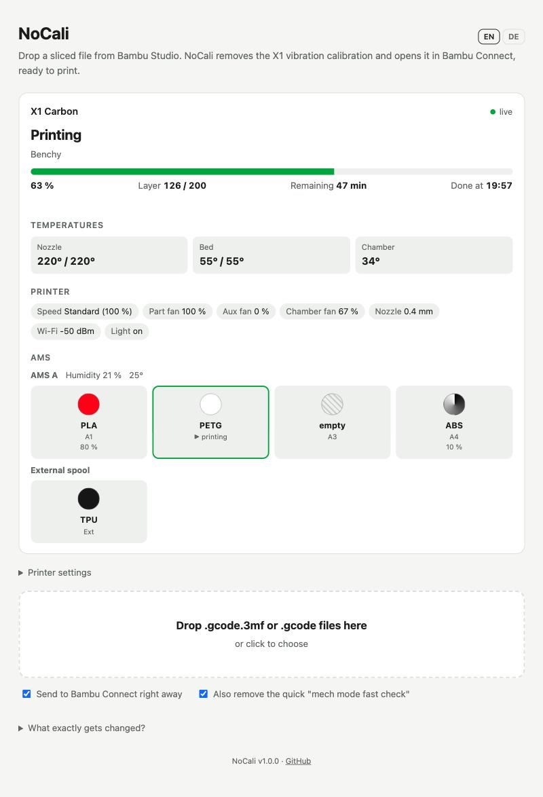

# NoCali

**Skip the X1 vibration calibration, and watch your Bambu Lab printer live, from one small local web page.**

NoCali is a tiny helper for Bambu Lab printers (made for the **X1 Carbon / X1**). Drop a sliced file on its page and it:

1. **removes the vibration (resonance) calibration** from the G-code, so the print starts without the loud shaking,
2. **opens the cleaned file in [Bambu Connect](https://wiki.bambulab.com/en/software/bambu-connect)**, where you pick the printer and press *Print*,
3. **shows the printer live**: progress, layers, time left, current step, temperatures, fans, speed, Wi-Fi, AMS filaments, HMS errors in plain text, and the camera.

Your printer stays in normal cloud mode (Bambu Handy keeps working). Everything runs on your own computer; no account, no cloud service.



> 🇩🇪 [Deutsche Kurzanleitung weiter unten](#deutsch)

## Features

| | |
|---|---|
| **Calibration removal** | Comments out `M970` / `M970.3` / `M974` in the start G-code, keeps `M975 S1` (the printer keeps using its stored compensation), recomputes the `.md5` checksums inside `.gcode.3mf`. |
| **One-click send** | Hands the cleaned file to Bambu Connect via its official `bambu-connect://` link. |
| **Live status** | State, progress, layer, remaining time and finish time, current stage (vibration calibration highlighted, so you can check it's gone), nozzle/bed/chamber temperatures. |
| **Printer details** | Speed level, part/aux/chamber fans, nozzle size, Wi-Fi signal, chamber light. |
| **AMS** | All slots with colour, material, remaining %, active slot, humidity and temperature; external spool. |
| **Errors** | HMS and print errors with Bambu's official text (in your language) and a link to the Bambu wiki. |
| **Camera** | Live view of the X1 camera (needs [ffmpeg](https://ffmpeg.org)). Only runs while you're watching. |
| **Printer discovery** | Finds printers on your network, even while Bambu Studio is open. |
| **English / Deutsch** | Picks your browser language; switch anytime. |
| **No dependencies** | Python standard library only. ffmpeg is optional (camera). |

## Requirements

- **Python 3.8+**: preinstalled on macOS (`/usr/bin/python3`) and most Linux; on Windows get it from [python.org](https://www.python.org/downloads/).
- **Bambu Connect** (Windows/macOS) for sending prints. Without it you can still download the cleaned file.
- **Printer on the same network**, and its **LAN access code** (printer screen → *Settings → Network*) for the live status.
- Optional: **ffmpeg** for the camera (`brew install ffmpeg`, `winget install Gyan.FFmpeg`, or your Linux package manager).

## Install

```bash
git clone https://github.com/HanSur94/nocali.git
cd nocali
```

**macOS / Linux**: installs to your user folder and starts at login (LaunchAgent / systemd user service):

```bash
sh install/install.sh
```

**Windows** (PowerShell):

```powershell
powershell -ExecutionPolicy Bypass -File install\install.ps1
```

Then open **http://localhost:7311**. To update, `git pull` and run the installer again. To remove the login item, run the installer with `uninstall`.

Just trying it? Run it without installing: `python3 app/server.py`.

## Use

1. In Bambu Studio, slice and use **Export plate sliced file** (`.gcode.3mf`).
2. Drop the file on http://localhost:7311.
3. Bambu Connect opens with the cleaned file: choose the printer and press **Print**.

The first time, open **Printer settings**, click **Find printer on network**, pick your printer and enter the access code to get the live status.

### Alternative: directly in Bambu Studio

If you don't need Bambu Connect, let Bambu Studio (or OrcaSlicer) clean every slice itself:
*Process → Others → Post-processing Scripts* (Advanced mode on):

```
/usr/bin/python3 "/path/to/nocali/app/nocali_post.py";
```

On Windows: `"C:\Path\To\python.exe" "C:\Path\To\nocali\app\nocali_post.py";`

### No install at all

[`standalone/nocali.html`](standalone/nocali.html) is a single page that cleans files right in your browser (download only, no printer status).

## How it works

- **G-code**: the X1 start G-code shakes each axis with `M970`/`M970.3` and fits the result with `M974`. NoCali turns those lines into comments (`; [NoCali] M970 …`), so line numbers stay the same. The quick "mech mode fast check" can be kept via a checkbox.
- **Status**: NoCali connects to the printer's local MQTT broker (port 8883, TLS, user `bblp`, your access code) and **only reads** the status reports. It never sends print or motion commands.
- **Camera**: the X1 streams RTSPS on port 322; ffmpeg converts it to MJPEG for the browser at 4 fps.
- **Error texts**: downloaded from Bambu's public HMS table (the one Bambu Studio uses) and cached for a week.

## Privacy & security

- The web page only listens on `localhost` and refuses requests from other websites.
- The access code is stored only on your computer (`printer.json` in the data folder, readable only by you) and never sent back to the page.
- The printer uses a self-signed certificate, so certificate checks are turned off for the printer connection (local network only).
- Data folder: macOS `~/Library/Application Support/NoCali`, Windows `%APPDATA%\NoCali`, Linux `~/.local/share/nocali`. Cleaned files are deleted after 7 days.

## Good to know

- The vibration calibration tunes the printer's vibration compensation. Skipping it uses the last stored values. After moving the printer, changing belts or other mechanical work, print once **without** NoCali.
- Tested with an X1 Carbon on firmware 01.12. Other models (P1, A1) should show status, but the calibration removal targets X1 start G-code.
- Not affiliated with or endorsed by Bambu Lab.

## Development

```bash
python3 -m unittest discover -s tests -v   # tests (incl. a simulated printer)
python3 tests/demo.py                       # UI against a simulated printer on :7399
```

---

<a id="deutsch"></a>
## 🇩🇪 Deutsch

**NoCali** entfernt die Vibrationskalibrierung des X1 Carbon aus Bambu-Studio-Dateien, schickt sie mit einem Klick an Bambu Connect und zeigt den Drucker live an: Fortschritt, Temperaturen, Lüfter, AMS-Filamente, Fehlermeldungen und Kamera.

**Installation**

```bash
git clone https://github.com/HanSur94/nocali.git
cd nocali
sh install/install.sh          # macOS / Linux
```

Windows: `powershell -ExecutionPolicy Bypass -File install\install.ps1`

Danach **http://localhost:7311** öffnen.

**Benutzung**

1. In Bambu Studio slicen und **Export plate sliced file** wählen (`.gcode.3mf`).
2. Datei auf die NoCali-Seite ziehen.
3. Bambu Connect öffnet sich: Drucker wählen und **Drucken** drücken.

Für den Live-Status einmal **Druckereinstellungen** öffnen, **Drucker im Netzwerk suchen** klicken, Drucker wählen und den Zugangscode eingeben (am Drucker: *Einstellungen → Netzwerk*). Für die Kamera wird ffmpeg benötigt (`brew install ffmpeg`).

Nach Umbauten am Drucker (Riemen, Standortwechsel) einmal **ohne** NoCali drucken, damit die Kalibrierung neu läuft.

## License

[MIT](LICENSE)
